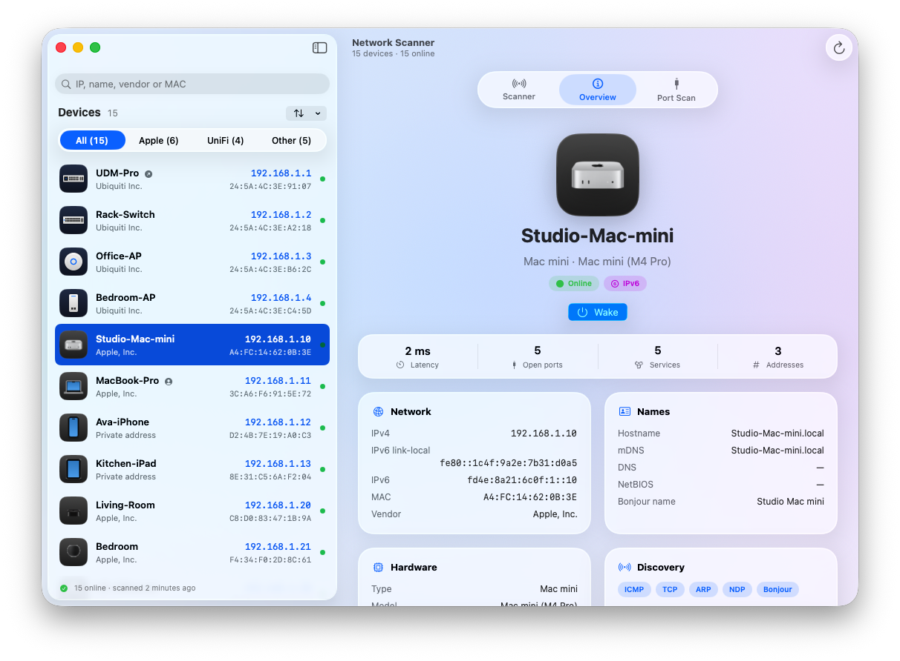

<p align="center">
  
</p>

<h1 align="center">Network Scanner</h1>

<p align="center">A native network scanner for macOS that finds every device on your network and identifies it, with a Liquid Glass design.</p>

<p align="center">
  <picture>
    <source media="(prefers-color-scheme: dark)" srcset="docs/screenshot-dark.png">
    
  </picture>
</p>

## Features

- **Scans a subnet or IP range** over IPv4 and IPv6, combining ping, TCP probes, the ARP and neighbor caches, Bonjour, NetBIOS and UniFi discovery
- **Identifies each device** by name, vendor, MAC, type and model, with macOS's own picture of each Apple product and matching icons for UniFi gear and everything else
- **Port scan** for any device: common ports, 1–1024, 1–10000, all 65,535 or your own list, with links to open web, SSH, SMB and screen sharing
- **Wi-Fi scan** with the Mac's own Wi-Fi card: nearby networks with their signal, channel, band, width, security and Wi-Fi generation, a channel chart, and details of the current connection
- **Wake-on-LAN** for Macs, PCs, servers and network storage, showing when each one answers
- **Open in UniFi Network**, which takes a UniFi gateway, switch or access point straight to its panel on your console
- **Offline vendor lookup** from the IEEE registry, updatable from Settings
- In English, Spanish (Spain and Latin America), French, German, Italian, Portuguese (Brazil), Japanese and Chinese (Simplified), following your Mac's language

Requires macOS 26 or later. The app runs natively on Apple silicon and Intel.

## Build from source

You need Xcode 26, which compiles the Liquid Glass icon and the translations. Select it once:

```bash
sudo xcode-select -s /Applications/Xcode.app/Contents/Developer
xcodebuild -runFirstLaunch
```

Then build:

| Command | What it does |
|:--|:--|
| `./build-app.sh` | Builds the universal, ad-hoc signed app into `build/Network Scanner.app` |
| `./build-app.sh --open` | Also opens it |
| `Scripts/update-strings.sh` | Adds new UI text from the code to `Resources/Localizable.xcstrings` |
| `Scripts/check-strings.py` | Checks that every string is translated in every language |
| `Scripts/make-icon.sh` | Re-renders the icon files from `Resources/AppIcon.icon` |

For development, `swift run` also works, in English and without the app icon.

The first scan asks for **Local Network** access; allow it, or scans find nothing. Rebuilt ad-hoc signed apps can lose that permission, so if scans come back empty, allow Network Scanner again in **System Settings → Privacy & Security → Local Network**.

The Wi-Fi tab asks for **Location** access, because macOS shows network addresses (BSSIDs) and the name of the connected network only to apps that have it. Without it, the tab still lists nearby networks with their channel, signal and security. The app never reads your actual location.

Translations live in `Resources/Localizable.xcstrings`, and the permission prompts' text in `Resources/InfoPlist.xcstrings`. To add a language, translate every key into it; `check-strings.py` lists any that are missing.

## Command line

The app binary can also scan from a terminal and print a table:

```bash
"build/Network Scanner.app/Contents/MacOS/NetScanner" --scan 192.168.1.0/24 --verbose
```

A port scan takes `common`, `wellKnown`, `extended`, `all` or a list such as `"22,80,8000-8100"`:

```bash
"build/Network Scanner.app/Contents/MacOS/NetScanner" --ports 192.168.1.1 all
```

`--wifi` lists the Wi-Fi networks around you. From a terminal, BSSIDs show only if the terminal app has Location access:

```bash
"build/Network Scanner.app/Contents/MacOS/NetScanner" --wifi
```

`--demo` opens the window on a made-up network and made-up Wi-Fi networks instead of scanning, as in the screenshot above. Add `--light` or `--dark` to pick the appearance:

```bash
open "build/Network Scanner.app" --args --demo --dark
```

## Good to know

- macOS keeps ARP entries for up to about 20 minutes, so a device that just left the network can still show once.
- On other subnets, devices are found by ping and TCP and named through DNS. Their MAC addresses aren't visible across a router.
- Only scan networks you own or are allowed to test.

## License

Copyright © 2026 Advandz Technologies, LLC. Released under the [MIT License](LICENSE.md).
